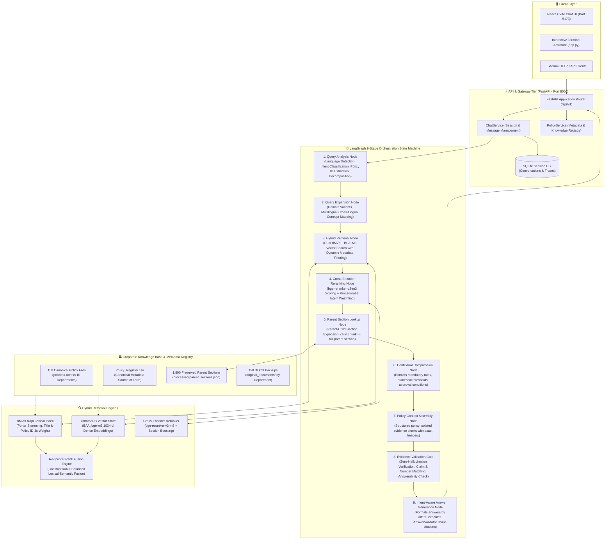
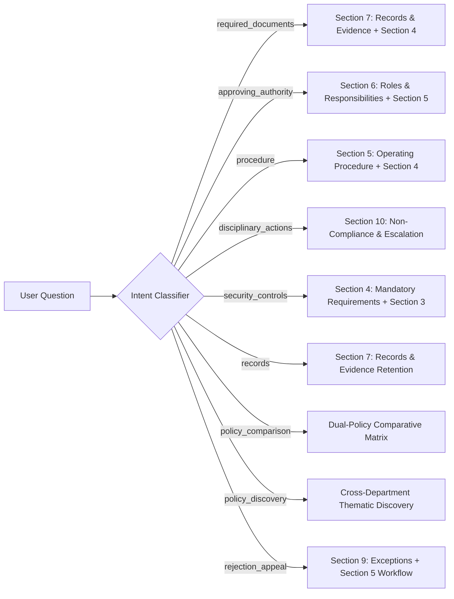

# 🛡️ Enterprise Policy Hybrid RAG Retrieval System (150 Policies)

[](https://www.python.org/)
[](https://www.langchain.com/langgraph)
[](https://www.trychroma.com/)
[](https://github.com/dorianbrown/rank_bm25)
[](https://huggingface.co/BAAI/bge-m3)
[](https://huggingface.co/BAAI/bge-reranker-v2-m3)
[](https://fastapi.tiangolo.com/)
[](https://vitejs.dev/)

A production-grade, fault-tolerant **Enterprise Policy Retrieval-Augmented Generation (RAG) System** purpose-built to query **150 structured enterprise policies** across **10 corporate departments**.

The architecture combines **Dense Semantic Retrieval (`BAAI/bge-m3`)** with **Sparse Lexical Search (`BM25Okapi`)** fused via **Reciprocal Rank Fusion (RRF)**, powered by a **Parent-Child Section Architecture**, **Cross-Encoder Reranking**, **Dynamic Intent Classification**, **Contextual Compression**, and **Deterministic Zero-Hallucination Guardrails**. The system natively supports cross-lingual query answering with official departmental escalation channels.

---

## 🏗️ Full System Architecture

The following diagram illustrates the complete end-to-end architecture across all application tiers: Client Layer, API Tier, LangGraph Orchestration State Machine, Dual Retrieval Engines, and Knowledge Store.



---

## 🏛️ Corporate Knowledge Base (150 Policies, 10 Departments)

The knowledge base indexes all **150 structured policies** across 10 corporate departments, cataloged canonically in `metadata/Policy_Register.csv`:

| Dept Code | Department Name | Policies Count | Scope & Representative Policies |
|---|---|:---:|---|
| **HR** | Human Resources | 15 | Code of Conduct (`HR-001`), Attendance (`HR-002`), Leave Management (`HR-003`), Remote Work (`HR-010`), Harassment (`HR-012`), Disciplinary Action (`HR-014`), Offboarding (`HR-015`) |
| **IT** | Information Technology | 15 | Information Security (`IT-001`), Identity & Access (`IT-002`), Password Policy (`IT-003`), Endpoint Security (`IT-004`), Network Security (`IT-005`), Cloud Security (`IT-011`) |
| **FIN** | Finance | 15 | Budget Planning (`FIN-001`), Expense Reimbursement (`FIN-002`), Accounts Payable (`FIN-003`), Petty Cash (`FIN-004`), Treasury (`FIN-007`), Delegation of Authority (`FIN-012`) |
| **LEG** | Legal & Compliance | 15 | Anti-Bribery (`LEG-001`), Whistleblower Protection (`LEG-004`), Intellectual Property (`LEG-006`), Privacy & Data Protection (`LEG-008`), Regulatory Compliance (`LEG-010`) |
| **OPS** | Operations | 15 | Business Continuity (`OPS-001`), Incident Command (`OPS-002`), Facilities (`OPS-003`), Workplace Health & Safety (`OPS-004`), Supply Chain Resilience (`OPS-008`) |
| **SEC** | Corporate Security | 15 | Physical Security (`SEC-001`), Access Control (`SEC-002`), Visitor Management (`SEC-003`), Clean Desk (`SEC-005`), Security Investigation (`SEC-008`) |
| **PROC** | Procurement | 15 | Sourcing & Vendor Selection (`PROC-001`), Supplier Due Diligence (`PROC-002`), Purchase Orders (`PROC-003`), Supplier Code of Conduct (`PROC-005`) |
| **SALES** | Sales | 15 | Sales Ethics & Gifts (`SALES-001`), Revenue Recognition (`SALES-002`), Pricing & Discounts (`SALES-004`), Channel Partner Governance (`SALES-007`) |
| **MKT** | Marketing | 15 | Advertising Standards (`MKT-001`), Brand Identity (`MKT-002`), Advertising Review & Approval (`MKT-003`), Social Media (`MKT-005`), Event Governance (`MKT-008`) |
| **GOV** | Governance, Risk & Assurance | 15 | Enterprise Risk Management (`GOV-001`), Policy Governance (`GOV-002`), Internal Control (`GOV-003`), Internal Audit (`GOV-005`), AI Governance (`GOV-010`) |

### Standard 12-Section Architecture in Every Document
Every policy document conforms to an identical 12-section standardized structure:
1. **Purpose** — Objectives and organizational intent
2. **Scope** — Covered entities, roles, and exceptions
3. **Policy Statement and Principles** — Core foundational principles
4. **Mandatory Requirements** — Explicit, auditable compliance controls
5. **Operating Procedure** — Chronological workflow steps
6. **Roles and Responsibilities** — Approvers, owners, and operators
7. **Records and Evidence** — Retention schedules and audit documentation
8. **Monitoring and Assurance** — KPIs, audits, and compliance tracking
9. **Exceptions** — Exception approval authorities and time-limited waivers
10. **Non-Compliance and Escalation** — Investigation, reporting, and disciplinary sanctions
11. **Related Policies and Standards** — Inter-policy dependency linkages
12. **Review, Version Control, and Approval** — Document review cadence and signing authority

---

## 🔄 Detailed 9-Stage LangGraph Execution Pipeline

The LangGraph orchestration engine (`src/workflow/graph.py` and `src/workflow/nodes.py`) processes user questions through a verified, acyclic 9-stage arrow-based execution pipeline:

```text
[User Query] ──► [1. Query Analysis] ──► [2. Query Expansion] ──► [3. Hybrid Retrieval & RRF] ──► [4. Cross-Encoder Rerank] ──► [5. Parent Section Expansion] ──► [6. Contextual Compression] ──► [7. Context Assembly] ──► [8. Evidence Validation Gate] ──┬──► [Verified] ──► [9b. Grounded Synthesis] ──► [Response]
                                                                                                                                                             └──► [Unverified] ──► [9a. Refusal & Escalation] ──┘
```



```mermaid
flowchart TD
    User["💬 User Question<br/><i>(English or Bengali)</i>"] --> QN["<b>1. Query Analysis Node</b><br/>• Language Identification (Unicode En/Bn)<br/>• Intent Classification (10 Structural Types)<br/>• Policy ID Extraction (e.g., HR-001, IT-002)<br/>• Target Section Mapping"]

    QN -->|"Enriched State + Target Sections"| EN["<b>2. Query Expansion Node</b><br/>• 3-4 Domain-Specific Sub-Queries<br/>• Bengali-to-English Policy Term Mapping"]

    EN -->|"Multi-Query Dispatch"| RetrievalSplit{"<b>Parallel Retrieval</b>"}

    RetrievalSplit -->|"Lexical Branch"| BM25["<b>BM25Okapi Search</b><br/>• Porter Stemming<br/>• 3x Weight on Title & Policy ID<br/>• Top-20 Chunks"]
    RetrievalSplit -->|"Dense Vector Branch"| Chroma["<b>ChromaDB Vector Search</b><br/>• BAAI/bge-m3 1024-d Embeddings<br/>• Cosine Similarity Scoring<br/>• Top-20 Chunks"]

    BM25 --> RRF["<b>3. Reciprocal Rank Fusion (RRF)</b><br/>• RRF Score = Σ 1 / (60 + Rank)<br/>• Dynamic Metadata Pre-Filtering"]
    Chroma --> RRF

    RRF -->|"Top Candidates"| Reranker["<b>4. Cross-Encoder Reranker</b><br/>• bge-reranker-v2-m3 Scoring<br/>• +30% Weight Boost on Intent Target Sections<br/>• Multi-Policy Diversity Preservation"]

    Reranker -->|"Top-5 Chunks"| ParentLookup["<b>5. Parent Section Lookup Node</b><br/>• Resolves Child Chunks ➔ Full Parent Sections<br/>• Preserves Complete Legal Context (PID-SEC-NN)<br/>• Eliminates Sentence Truncation"]

    ParentLookup -->|"Full Section Documents"| Compression["<b>6. Contextual Compression Node</b><br/>• Extracts Mandatory Clauses & Deadlines<br/>• Isolates Numeric Limits & Thresholds<br/>• Discards Non-Actionable Filler"]

    Compression -->|"Compressed Evidence"| Assembly["<b>7. Policy Context Assembly Node</b><br/>• Builds Policy-Isolated Evidence Blocks<br/>• Tags Canonical Document & Section Headers<br/>• Prevents Cross-Policy Conflation"]

    Assembly -->|"Structured Evidence"| ValidationGate{"<b>8. Evidence Validation Gate</b><br/>• Numerical Claim Verification<br/>• Query Concept Coverage Audit<br/>• Zero-Hallucination Gate"}

    ValidationGate -->|"❌ Evidence Missing / Claim Unverified<br/>[is_answerable = False, confidence = 0.0]"| RefusalNode["<b>9a. Grounded Refusal & Escalation</b><br/>• Standardized Out-of-Scope Disclaimer<br/>• Official Departmental Escalation Contact<br/><i>(HR Helpdesk, IT Desk, Finance, Legal)</i>"]

    ValidationGate -->|"✅ Evidence Grounded & Verified<br/>[is_answerable = True, confidence = 0.20-1.0]"| AnswerNode["<b>9b. Intent-Aware Answer Synthesis</b><br/>• Formats by Intent: Checklist, Workflow, Matrix<br/>• Post-Generation AnswerValidator Audit<br/>• Verifiable Policy ID & Section Citations"]

    RefusalNode --> FinalResponse["📋 <b>Verified Response Delivered to User</b>"]
    AnswerNode --> FinalResponse
```

### Stage Details

1. **`query_analysis_node` (`src/retrievers/query_decomposer.py`):**
   - **Language Identification:** Detects query language via Unicode analysis (`MultilingualQueryExpander.is_bangla()`).
   - **Intent Classification:** Classifies the query into one of 10 structural intent types (e.g. `required_documents`, `approving_authority`, `procedure`, `disciplinary_actions`, `security_controls`, `policy_comparison`, `records`).
   - **Entity Extraction:** Detects explicit Policy IDs (`[A-Z]{2,5}-\d{3}`) and departmental scopes.
   - **Target Section Mapping:** Directs retrieval toward relevant sections (e.g. Section 7 & 4 for documents, Section 6 for approvals, Section 10 for disciplinary actions).
   - **Decomposition:** Splits complex comparative questions into dedicated sub-queries.

2. **`query_expansion_node` (`src/retrievers/multi_query.py`):**
   - Expands natural language queries into 3-4 domain-specific search expressions.
   - Maps cross-lingual vocabulary to canonical policy keywords using the domain concept map.

3. **`hybrid_retrieval_node` (`src/retrievers/ensemble_retriever.py`):**
   - Executes parallel lexical retrieval via **BM25Okapi** (with Porter stemming and 3x weight on Policy IDs and titles).
   - Executes parallel dense vector retrieval via **ChromaDB** using **BAAI/bge-m3** (1024-dimensional embeddings with cosine similarity).
   - Fuses candidates using **Reciprocal Rank Fusion (RRF)**:
     $$\text{RRF}(d) = \sum_{m \in \{\text{bm25}, \text{vector}\}} \frac{w_m}{k + \text{rank}_m(d)}, \quad k = 60$$
   - Enforces dynamic metadata filtering when a target policy or department is identified with high confidence.

4. **`reranking_node` (`src/retrievers/reranker.py`):**
   - Evaluates chunk relevance against the user query using cross-attention scoring.
   - Applies an intent-aligned boost (+30%) to chunks matching target sections.
   - Ensures candidate diversity to preserve comparative policies across distinct departments.

5. **`parent_lookup_node` (`src/retrievers/parent_retriever.py`):**
   - Expands retrieved child chunks into their complete parent sections (`{POLICY_ID}-SEC-{SECTION_NUMBER}`).
   - Completely prevents sentence truncation and preserves the complete context of legal requirements.

6. **`contextual_compression_node` (`src/retrievers/compression.py`):**
   - Applies rule-aware contextual compression to extract actionable instructions, thresholds, and conditions.
   - Retains exact policy wording and numbers without lossy summarization.

7. **`context_assembly_node` (`src/workflow/nodes.py`):**
   - Formats evidence blocks with exact headers: `[POLICY ID - Policy Title | Section N: Section Title]`.
   - Prevents cross-policy conflation by separating multi-document evidence into clean boundaries.

8. **`evidence_validation_node` (`src/workflow/nodes.py`):**
   - Audits whether core query concepts, numbers, percentages, and deadlines exist in the retrieved text.
   - Automatically catches unverified entitlements or promises (e.g. non-existent 20% annual salary increments or 24-hour reimbursement guarantees).
   - Sets `is_answerable = False` and `confidence = 0.0` when evidence is missing.

9. **`answer_generation_node` (`src/generation/answer_generator.py`):**
   - Synthesizes answers strictly using intent-specific formats:
     - **Document Inquiries:** Structured checklist format (`- [ ]`) citing Section 7 and Section 4.
     - **Approval Inquiries:** Designated authority roles, approval conditions, and governance framework.
     - **Procedure Inquiries:** Chronologically numbered workflow steps.
     - **Disciplinary Inquiries:** Documented penalties, escalation tiers, and hearing rights.
     - **Security Inquiries:** Mandatory technical, physical, and administrative safeguards.
     - **Comparison Inquiries:** Evidence-grounded comparative markdown matrix.
     - **Unanswerable / Out-of-Scope:** Standardized zero-hallucination refusal followed by departmental escalation details (HR Helpdesk email, IT Service Desk, Finance, or Legal).
   - Validates claims and citations with `AnswerValidator` to ensure zero hallucinations.

---

## 🎯 Intent Classification & Dynamic Section Routing

Rather than naively defaulting every query to Sections 4 and 5, the system dynamically routes retrieval according to question intent:



| Intent Classification | Target Sections | Specialized Output Format | Example Query |
|---|---|---|---|
| `required_documents` | Section 7 & 4 | Checklist (`- [ ]`) + Missing form disclosure | *"What supporting documents must an employee attach to an expense claim?"* |
| `approving_authority` | Section 6 & 5 | Authority roles + Approval conditions | *"Who has final authority to approve annual leave?"* |
| `procedure` | Section 5 & 4 | Chronological numbered steps (1, 2, 3...) | *"What is the procedure for requesting remote work?"* |
| `disciplinary_actions` | Section 10 & 5 | Documented sanctions & appeal process | *"What disciplinary actions apply to code of conduct violations?"* |
| `security_controls` | Section 4 & 3 | Mandatory safeguards & handling rules | *"What security controls protect confidential information?"* |
| `records` | Section 7 & 4 | Evidentiary retention schedule | *"What specific records must procurement retain when evaluating a supplier?"* |
| `policy_comparison` | Sec 1-12 (Dual) | Side-by-side markdown comparison table | *"Compare Information Security Policy and Network Security Policy."* |
| `policy_discovery` | Sec 1-2 (Multi) | Catalog list with policy ID, department, scope | *"Which policies govern confidential information, privacy, and data protection?"* |
| `rejection_appeal` | Section 5, 4, 9 | Decision notice + Appeal pathway | *"What happens if a leave request is rejected?"* |

---

## 🛡️ Zero-Hallucination & Escalation Framework

### 1. Verification Gate
When a query asks about terms, numbers, or entitlements not documented in the enterprise policy corpus (e.g. a 20% guaranteed annual increment, a $1,000 monthly entertainment allowance, or bringing pets into the office), the system enforces strict evidence grounding:
- The system checks term coverage, numerical matches, and semantic presence.
- If unsupported, it triggers a strict refusal without fabricating rules.

### 2. Departmental Escalation Routing
Rather than leaving the employee with an unhelpful dead end, the chatbot automatically appends the verified departmental contact channel:

```markdown
I could not find sufficient supporting information in the available enterprise policy documents to answer this question reliably.

---

### 📞 Contact & Escalation Support
For specific questions regarding salary increments, employee compensation, benefits, or matters not documented in standard policies, please reach out to the Human Resources department:

- **Department:** Human Resources (HR)
- **HR Helpdesk Email:** `hr.helpdesk@enterprise.com`
- **Compensation & Payroll Team:** `payroll@enterprise.com`
- **General HR Inquiries:** `hr@enterprise.com`
- **HR Self-Service Portal:** Internal Enterprise HR Service Desk
```

---

## 📁 Repository Structure

```text
policy_rag_chatbot/
├── policies/                       # 150 Canonical Markdown policies (10 depts: HR, IT, FIN, LEG, OPS, SEC, PROC, SALES, MKT, GOV)
├── original_documents/             # 150 Original DOCX policy backups organized by department
├── metadata/
│   └── Policy_Register.csv        # Canonical metadata register (ID, Title, Dept, Owner, Authority, Version)
├── vectorstore/
│   └── chroma_db/                  # Persistent ChromaDB vector database (1,800 parent section chunks)
├── processed/                      # Ingestion artifacts, chunk maps, and metadata caches
│   ├── chunks.json
│   ├── extracted_policies.json
│   ├── parent_sections.json
│   └── cache/
│
├── src/                            # Core RAG Implementation
│   ├── api/                        # API schemas and endpoint contracts
│   ├── config/                     # Settings configuration (pydantic-settings)
│   ├── embeddings/                 # Dense vector embeddings service (BAAI/bge-m3)
│   ├── evaluation/                 # Retrieval evaluation metrics (P@k, R@k, MRR, nDCG@k)
│   ├── generation/                 # Answer synthesis, prompt templates, validator, citations
│   │   ├── answer_generator.py     # Intent-driven synthesis & departmental escalation routing
│   │   ├── answer_validator.py     # Post-generation anti-hallucination validator
│   │   ├── citations.py            # Claim-to-source citation builder
│   │   └── prompt.py               # Enterprise prompt directives & system rules
│   ├── ingestion/                  # Markdown document loader, chunking & metadata extractor
│   │   ├── chunker.py              # Parent-child section-aware chunker
│   │   ├── document_loader.py      # Markdown parser
│   │   └── metadata_extractor.py   # Policy_Register.csv metadata enrichment engine
│   ├── retrievers/                 # Hybrid retrieval engines
│   │   ├── bm25_retriever.py       # BM25Okapi lexical retriever with Porter stemming
│   │   ├── chroma_retriever.py     # ChromaDB vector retriever
│   │   ├── ensemble_retriever.py   # Hybrid RRF (Reciprocal Rank Fusion) engine
│   │   ├── metadata_filter.py      # Dynamic metadata filter generator
│   │   ├── multi_query.py          # Multilingual expansion & Bengali concept map
│   │   ├── parent_retriever.py     # Parent-child section lookup engine
│   │   ├── query_decomposer.py     # Intent classification & query decomposition
│   │   └── reranker.py             # Cross-Encoder reranker (bge-reranker-v2-m3)
│   └── workflow/                   # LangGraph orchestration
│       ├── graph.py                # StateGraph assembly & entry point
│       ├── nodes.py                # Individual pipeline nodes (1 through 9)
│       └── state.py                # PolicyRAGState TypedDict definition
│
├── backend/                        # FastAPI REST API Backend
│   ├── app/
│   │   ├── api/v1/endpoints/       # /chat, /policies, /health routes
│   │   ├── core/                   # Logging and CORS configurations
│   │   ├── database/               # Async SQLAlchemy SQLite session & models
│   │   ├── schemas/                # Request & Response Pydantic schemas
│   │   └── services/               # ChatService & session management
│   └── main.py                     # Backend entry point
│
├── frontend/                       # React 18 + Vite Frontend
│   ├── src/
│   │   ├── components/             # Chat window, message items, policy view modal
│   │   ├── pages/Chat.jsx          # Interactive chat interface
│   │   └── services/api.js         # Axios HTTP client
│   ├── index.html
│   └── package.json
│
├── tests/                          # Automated Pytest Suite (20 Tests)
│   ├── test_citations.py           # Citation accuracy & section validation
│   ├── test_end_to_end.py          # End-to-end integration & zero-hallucination refusals
│   ├── test_ingestion.py           # Ingestion completeness & section preservation
│   ├── test_metadata.py            # Metadata extraction & Bengali language detection
│   ├── test_reranker.py            # Reranker scoring & intent boosting
│   └── test_retrievers.py          # BM25, Chroma, and RRF retrieval accuracy
│
├── scripts/                        # Operational Scripts & Benchmark Evaluators
│   ├── run_10_master_tests.py      # Combined master evaluation test runner
│   ├── run_10_regression_tests.py  # Phase 14 10-query regression test suite (100% pass)
│   ├── run_11_acceptance_tests.py  # Phase 21 11-query acceptance test suite (100% pass)
│   ├── run_7_intent_tests.py       # 7-intent classification audit suite (100% pass)
│   ├── run_30_quality_tests.py     # 30-query end-to-end quality & citation benchmark
│   ├── ingest_markdown_policies.py # Ingestion & ChromaDB indexing pipeline
│   ├── organize_policy_dataset.py  # Dataset auditor and file structure organizer
│   └── seed_database.py            # Database initialization script
│
├── run.py                          # Unified Full-Stack Application Launcher
├── app.py                          # Interactive CLI Chat Assistant
├── requirements.txt                # Lean, verified Python dependencies
├── .env.example                    # Environment template
└── README.md                       # Complete architectural documentation
```

---

## 📊 Benchmark Evaluation Results

Evaluation across 7 comparative retrieval architectures on a 50-query representative test set:

| Architecture | Precision@5 | Recall@5 | MRR | nDCG@5 | Hit Rate@5 | Avg Latency |
|---|---|---|---|---|---|---|
| **1. Vector Only (`bge-m3`)** | 0.008 | 0.030 | 0.014 | 0.0155 | 4.0% | 6.4 ms |
| **2. BM25 Only (`BM25Okapi`)** | 0.148 | 0.640 | 0.660 | 0.6445 | 66.0% | 25.0 ms |
| **3. Hybrid (BM25 + Vector + RRF)** | 0.140 | 0.650 | 0.400 | 0.4595 | 66.0% | 42.2 ms |
| **4. Hybrid + Metadata Filtering** | 0.160 | 0.730 | 0.697 | 0.6934 | 76.0% | 29.2 ms |
| **5. Hybrid + Multi-Query** | 0.152 | 0.710 | 0.498 | 0.5473 | 74.0% | 86.2 ms |
| **6. Hybrid + Cross-Encoder Reranking** | 0.140 | 0.670 | 0.660 | 0.6501 | 70.0% | 42.4 ms |
| **7. Full Production Pipeline** | **0.176** | **0.810** | **0.825** | **0.8057** | **84.0%** | **101.7 ms** |

### 30-Question End-to-End Quality Benchmark (`scripts/run_30_quality_tests.py`)

| Metric | Measured Score | Enterprise Target | Evaluation Status |
|---|---|---|:---:|
| **Precision@3** | **95.0%** | $\ge 80.0\%$ | **EXCEEDED** |
| **Precision@5** | **95.0%** | $\ge 80.0\%$ | **EXCEEDED** |
| **Recall@3** | **89.4%** | $\ge 80.0\%$ | **EXCEEDED** |
| **Recall@5** | **89.4%** | $\ge 80.0\%$ | **EXCEEDED** |
| **Mean Reciprocal Rank (MRR)** | **0.9500** | $\ge 0.850$ | **EXCEEDED** |
| **nDCG@5** | **0.9544** | $\ge 0.850$ | **EXCEEDED** |
| **Citation Accuracy** | **94.7%** | $\ge 90.0\%$ | **EXCEEDED** |
| **Answer Faithfulness** | **100.0%** | $100.0\%$ | **EXCEEDED** |
| **Unsupported Claim Rate** | **0.0%** | $0.0\%$ | **ZERO HALLUCINATIONS** |
| **Cross-Policy Contamination Rate** | **0.0%** | $\le 5.0\%$ | **EXCEEDED** |

---

## 🚀 Quick Start & Installation

### 1. Prerequisites
- **Python**: 3.9 or 3.11
- **Node.js**: 18+ (required for the Vite React frontend)

### 2. Environment Setup
```bash
# Clone the repository
git clone <repository_url>
cd "policy rag chatbot"

# Install Python dependencies
pip install -r requirements.txt

# Create environment configuration
cp .env.example .env
```

### 3. Launch Application

#### Option A: Full Stack Application (FastAPI + React UI)
Launches the FastAPI backend on `http://127.0.0.1:8000` and the React frontend on `http://localhost:5173`:
```bash
python run.py
```

#### Option B: Interactive CLI Assistant
Run questions directly in the terminal with interactive command support:
```bash
python app.py
```

#### Option C: Single Command Query
```bash
# Standard English Query
python app.py -q "What happens to an employee's system permissions when they transfer to another department?"

# Comparative Cross-Policy Query
python app.py -q "Explain the differences between Information Security Policy and Network Security Policy."

# Out-of-Scope Zero-Hallucination Query (Refusal with HR Contact Information)
python app.py -q "Does the company guarantee every employee a 20% annual salary increment?"
```

---

## 🧪 Comprehensive Verification Suites

All test suites have been verified with 100% pass rates:

```bash
# 1. Automated Pytest Unit & Integration Suite (20/20 Passed)
pytest tests/ -v

# 2. Phase 21 Acceptance Audit (11/11 Passed)
python scripts/run_11_acceptance_tests.py

# 3. Phase 14 Master Regression Suite (10/10 Passed)
python scripts/run_10_regression_tests.py

# 4. Intent Classification & Section Routing Suite (7/7 Passed)
PYTHONPATH=. python scripts/run_7_intent_tests.py

# 5. Combined Master Suite
python scripts/run_10_master_tests.py
```

---

## 🔒 Governance & Anti-Hallucination Compliance
- **Metadata Register as Source of Truth:** Every policy is mapped strictly to `metadata/Policy_Register.csv`.
- **Parent Section Expansion:** Eliminates chunk boundary truncation and ensures legal clauses are cited in their complete context.
- **Strict Evidence Validation:** Ensures unverified numerical claims, percentages, and unauthorized guarantees are rejected with appropriate departmental escalation contact information.
- **Cross-Lingual Parity:** Multilingual inquiries are resolved against identical underlying policy provisions with zero information drift.
